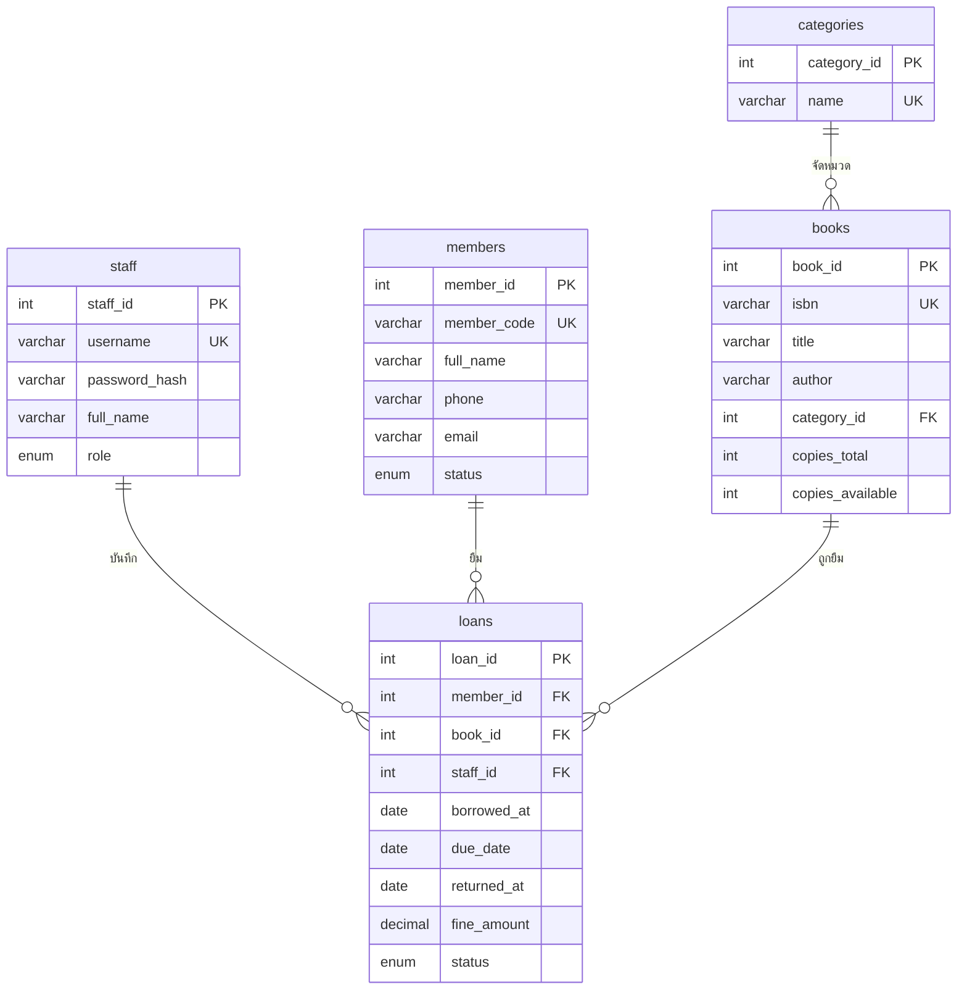

# การออกแบบ ER และสถาปัตยกรรม (Design: ER & Architecture)

| รายการ | ค่า |
|---|---|
| รหัส SCI | SCI-003 |
| ชื่อเอกสาร | การออกแบบ ER และสถาปัตยกรรม |
| โครงการ | Circulation Desk – ระบบยืม-คืนหนังสือ |
| เวอร์ชันเอกสาร | 0.1.0 |
| สถานะ | Baseline |

## ประวัติการแก้ไข

| เวอร์ชัน | วันที่ | ผู้แก้ไข | รายละเอียด |
|---|---|---|---|
| 0.1.0 | 2026-10-29 | ผู้พัฒนา | จัดทำฉบับ baseline (สร้างขึ้นใหม่ในเครื่อง ดู CR-001) |

## 1. แผนภาพ ER



## 2. คำอธิบายตาราง

| ตาราง | หน้าที่ | หมายเหตุ |
|---|---|---|
| `staff` | บัญชีเจ้าหน้าที่ | รหัสผ่านเก็บเป็น `password_hash()` (bcrypt) |
| `members` | สมาชิกห้องสมุด | `status` = `active` / `suspended` ไม่มีการลบ |
| `categories` | หมวดหมู่หนังสือ | ชื่อไม่ซ้ำ |
| `books` | ระเบียนหนังสือ (ระดับชื่อเรื่อง) | `isbn` ว่างได้ (NULL) แต่ไม่ซ้ำ, `copies_available <= copies_total` |
| `loans` | รายการยืม-คืน | `status` = `borrowed` / `returned`, `fine_amount` บันทึกตอนคืน |

ค่าคงเหลือ: `copies_available` ต้องเท่ากับ `copies_total − จำนวน loans ที่ status='borrowed'` ของหนังสือนั้นเสมอ

## 3. สถาปัตยกรรม

```text
Browser ──HTTP──> src/public/*.php  (หน้าเว็บ: รับคำขอ, ตรวจ CSRF, เรียกบริการ, แสดงผล)
                      │ require
                      ▼
                  src/lib/          (bootstrap, db, auth, csrf, helpers)
                  src/services/     (ตรรกะธุรกิจ: Book, Category, Member, Loan, Report)
                  src/views/        (layout และ partial)
                      │ PDO + prepared statements
                      ▼
                  MySQL 8.0 / MariaDB (circulation_desk)
```

- DocumentRoot คือ `src/public` เท่านั้น ไฟล์ `config`, `lib`, `services`, `views` อยู่นอก DocumentRoot
- ค่าตั้งระบบอ่านจากตัวแปรสภาพแวดล้อมก่อน (Docker) แล้วจึงอ่านจากไฟล์เฉพาะเครื่อง (XAMPP)
- กฎธุรกิจ BR-01..BR-04 เก็บเป็นค่าใน `config.php` ที่เดียว
- การยืม/คืนทำใน transaction และล็อกแถวด้วย `SELECT ... FOR UPDATE`
